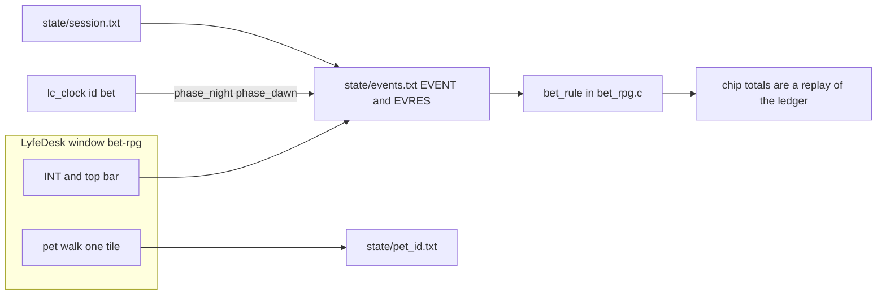

# bet-rpg — casino island

- **Date:** 2026-10-21
- **Status:** draft. Nothing is built. There is no `@.apps/bet-rpg` folder.
- **Product name the user sees:** LyfeDesk. Internal ids stay `livedesk` (clock op, taskbar, command prefix). Do not rename those here.
- **Labels:** SAID = the owner's words on 2026-10-21. READ = from files opened this pass, not from a run. MINE = a proposal. Numbers marked MINE are not house law.

## Overview

bet-rpg is a new LyfeDesk game window. The six pets already in the shooter walk an island town, sit at casino tables, and pay a hotel when the existing game clock enters night. Chips move only as ledger rows, so a hand and a night's bill can be replayed. A person at this desk sits a seat with the same verbs the pets use. The app does not open a socket.

This is not a mode inside `rpg-pvp-hq` and not a mode inside `game-dev-hq`.

## Background & Motivation

**SAID (2026-10-21).** A new project like the house game windows, named bet-rpg. It is a casino island. It has all the pets. The pets go to the casinos in town and play holdem, blackjack, roulette, slots, and craps. They pay to sleep in the hotels every night. There is a day/night cycle. Each hotel in town is for bigger spenders.

**READ.** The closest window is `44.xyz.01.00/@.apps/rpg-pvp-hq`.

- The window is `rpg-pvp-hq.xhtpm`: class `rpg-pvp-hq`, top bar INT, book (the pets), page, Shop, Menu, and a clock label. The module is `ops/+x/rpg_pvp_hq.+x`. Toys entry is `toy.pdl` (`title | rpg-pvp-hq`). The user-facing product around that window is LyfeDesk; the file names stay `livedesk` on purpose (`AGENTS.md` at the repo root, 2026-10-15).
- The header of `ops/rpg_pvp_hq.c` says every pet walks one tile per step by itself. INT takes the selected pet. INT off hands that pet back. The other pets keep walking. INT on advances the clock by the `TURN` row; INT off lets the clock run and the pets walk on a timer.
- Seats already exist in that app as text, not as a second network stack. `state/session.txt` (read 2026-10-21) starts `SESSION|rpg-1792564826-587549`. The six pets are `SEAT|<id>|agent|local`. Later rows are `SEAT|peer1|peer|peer`, `SEAT|rex|human|local`, `SEAT|rex|agent|local`, `SEAT|peer2|peer|peer`. The last row for `rex` is `agent|local`, not `human`. `RPG-PVP-HQ-SESSIONS.md` says a peer is one outbox line in `<app>/net/outbox.txt` and that `palnet_peer` moves the line. The app does not open a port. `08-roadmap/design-docs/CROSS-MACHINE-NETWORKING-PLAN.md` records `palnet_peer.c` binding `127.0.0.1`. `08-roadmap/design-docs/GAME-SESSIONS-SEATS-RATINGS-LOBBIES-PATTERN.md` (2026-10-07) is the seat law: `human`, `agent`, `peer`, `spectator`. bet-rpg will use last-row-wins as its own rule. It does not copy the shooter's `peer1` / `peer2` rows in as fixtures.
- The clock is not a private timer. `time.pdl` names `&.widgits/livedesk-clock/ops/+x/lc_clock.+x`, the phase hours, and `TURN | advance | 5m`. It does not name the clock id. The id `rpg` is a C string passed to `lc_run` in `rpg_pvp_hq.c` (`new`, `rate`, `cmd`, `reminder-add`, `advance`, `pause`). The mini root is `state/clock_root`. Phases: dawn 06:00, day 08:00, dusk 17:00, night 19:00, `day_tick` at 00:00. `write_phase` maps game hour to `state/daylight.txt` (`night` when hour >= 19 or hour < 6). The label is `D<n> HH:MM` in `state/clock_ui.txt`. Copying `time.pdl` alone would still talk to the shooter's clock if those call sites stay `rpg`.
- Rules go through one ledger. `&.widgits/_shared-lib/game_events.c` writes `EVENT|ts|actor|verb|target|at|queued` and one `EVRES` per applied row. The shared verb list is `give_item take walk dig build craft strike equip fire reload`. A verb not on that list is rejected for every game that includes the file (`ge_verb_ok`). `GE_RULE_HOOK` runs only after the verb is accepted. `rpg_pvp_hq.c` defines `#define GE_RULE_HOOK(a, v, t, at) cd_rule(...)` before the include. `cd_rule` owns `strike`, `equip`, `fire`, and `reload`. It does not add those names to a second global list; they were added to the shared `ge_verbs[]` array, so every other include of `game_events.c` now accepts them too (a game that does not handle them falls through to `todo:<verb>`).
- `S1-EVENT-LEDGER.md` still lists only the original six verbs. That page is behind the code. Positions in the shooter are `state/pet_<id>.txt` (`room`, `x`, `y`, `dir`, `steps`), not a chip balance.

**READ — where the old names come from.** `load_party` in `rpg_pvp_hq.c` reads `&.widgits/db-hq/data/system.pdl`. The default party name is `DsrRpgParty` (override `PET_PARTY`). `party.pdl` then overrides the picture. The shooter `party.pdl` is Joss, Keel, Moss, Ryn, Pike, and Sable on Actor2 indexes 0–5. game-dev-hq's `party.pdl` is Ivo, Ness, Quill, and Yara on Actor3 indexes 0–3. The old shared Rex sheets (People1–3 and Nature) are no longer what those two windows wear. People4 stays the island. Sheets live in `&.widgits/palettes/sprites/rmmv/dir_characters/`.

**SAID, 2026-10-21.** bet-rpg does not wear that cast. Same names and the same cells would make the island look like the shooter. The island gets its own six names and its own sprites. The shooter and the studio now use that same split. Each app's `party.pdl` is the name and the picture. `DsrRpgParty` is only the stat slot for the shooter. Old ledger rows that still say `rex` stay as history. New seats and `pet_<id>.txt` use the new ids.

**MINE — the island cast.** `bet_rpg.c` reads this app's `party.pdl` for the name and the picture. It does not call the shooter's default `DsrRpgParty`. Stats are the columns on that row (mhp through luk), copied as plain numbers, not new blocks in the shared `actors.pdl`. Sheets are People4 indexes 0 through 5, six cells the other two games do not use. No new art files.

| order | name | picture | runtime id |
| --- | --- | --- | --- |
| 1 | Vale | People4 index 0 | `vale` |
| 2 | Nia | People4 index 1 | `nia` |
| 3 | Sol | People4 index 2 | `sol` |
| 4 | Kit | People4 index 3 | `kit` |
| 5 | Bram | People4 index 4 | `bram` |
| 6 | Wynn | People4 index 5 | `wynn` |

Seat rows and `pet_<id>.txt` use that lowercase id. Harold stays the trainer question in Open Questions. He is not one of these six. `RpgPetParty` and `PetParty` stay unused here too.

`party.pdl` says each of these actors has an `entity_uid` (`state/uid_<id>.txt` in the shooter; `uid_rex.txt` is a 32-hex id). That identity is for the house wallet note in that file. **MINE:** bet-rpg chips are not that wallet and not a chain balance. Real payments stay out of scope.

## Goals & Non-Goals

**Goals**

- A fresh app folder `@.apps/bet-rpg` with the pet-window shape: top bar, six pets walking, INT on/off, LyfeDesk clock label, S1 ledger.
- An island town with three casinos and three hotels, one casino beside each hotel tier. Pets walk between them on the existing one-tile walk. A pet with no chips still walks. `sit` and `wager` stay blocked when chips or stamina are short.
- Five table games as verb sequences on that ledger, not five programs.
- A night bill when the clock phase becomes night. A hotel may refuse a pet. A pet who does not pay does not get the night's rest.
- A human seat that writes the same verbs as an agent seat.

**Non-goals**

- Real-money gambling, payments, accounts, or cash-out.
- Sockets, cross-machine play, or a new transport. A peer, if one is ever offered, is a `palnet_peer` outbox line. That peer still cannot leave this machine (`127.0.0.1`).
- A new pet cast, new pet art, a 3D camera, shooting, hit points, or Fortnite building.
- A mode flag inside `rpg-pvp-hq` or `game-dev-hq`.
- A second clock implementation. Same `lc_clock.+x`. Own mini root and own clock id so this window does not move the shooter's `rpg` clock.
- Elo, lobbies, and ranked play. The seat pattern allows them later. This draft does not turn chip totals into ratings.

## Proposed Design



### App shape

**MINE.** New folder `44.xyz.01.00/@.apps/bet-rpg`. One C op `ops/bet_rpg.c`. The shooter header lists four argv shapes and then calls them three: a verb and exit, the cli_io text form, resident mode, and event-runner mode when the clock fires `common:<event>`. bet-rpg implements three of those four: verb, resident, and event-runner. It does not take a free-text chat argv in v1. Window buttons stay direct verb calls, as the shooter's `onclick`s already are. `GE_LOG_HOOK` may still append a line to the on-screen log. That is not a chat prompt.

Reuse, by reading and then writing new files, not by living inside the shooter:

- Tabs PR 2 keeps: INT, book (the six pets), page (town rooms), Menu, Help, and the clock label. Do not copy Shop, Craft, Body, Inventory, Look, Player, Network, or the gun pages. Network would imply a peer seat, and v1 has none. The shooter book comment that says `PetParty` is stale for that window. bet-rpg's book lists Vale, Nia, Sol, Kit, Bram, and Wynn from its own `party.pdl`.
- Common chrome, same as the other pet windows, one of each (2026-10-21). Left pin `canvas-overlay-left`: phase, room name, and where each pet is. Right pin `canvas-overlay-right`: the chat log (door walks, a `say` line). One bottom bar only: the footer `pchq-footer` lists the players (the six names, plus chat and info toggles). Do not also put those names on a `canvas-overlay-bottom`. That second strip was a duplicate and is not part of the window. The menu sidebar is a 2px rail so it does not eat the map. Day and night tint the picture from `state/daylight.txt`: night 19:00–06:00, dawn until 08:00, day until 17:00, dusk until 19:00. Indoors the tint is milder. The island is an overmap. Buildings are World_B tiles in `rooms.pdl`. A door trigger is the cell under the door (`tx`, `ty+1`) and teleports both ways, the same ROOM / DOOR / SCENERY rows as rpg-pvp-hq.
- This app's `party.pdl` is the cast: Vale, Nia, Sol, Kit, Bram, Wynn on People4 indexes 0–5. Not `DsrRpgParty`. Not the shooter sheets.
- Walk: one tile per step, doors as event pages, other pets keep moving when INT holds one of them. Map glyphs can follow the city reader in `rpg_pvp_hq.c` (`. = # W D ,`) only as a 2D plan. No POV keys, no `scene` camera, no wounds.
- `time.pdl` carries the same phase hours (dawn 06:00, day 08:00, dusk 17:00, night 19:00, day tick 00:00) and `TURN | advance | 5m`. Every `lc_run` argument that the shooter hardcodes as `rpg` is `bet` in this op: `new`, `rate`, `cmd`, `reminder-add`, `advance`, and `pause`. The mini root is this app's `state/clock_root`, not the shooter's. Label text stays `D<n> HH:MM`. Night for the hotel walk is `phase=night` in this app's `state/daylight.txt`, which the 19:00 reminder writes, the same way `write_phase` treats hour >= 19 or hour < 6. Proof for that PR: the clock file under this root shows id `bet`, and the shooter's `rpg` clock file is byte-for-byte unchanged.

**Alternative (not the recommendation).** Later, rename-copy `rpg-pvp-hq` onto `@.apps/bet-rpg` and delete the shooter. That copies guns, wounds, city loot, and the `rpg` clock id, then spends a PR removing them. A fresh app that copies only the pet-window shape is smaller to review. The folder name is `bet-rpg` either way. Do not add a casino mode to the shooter.

### Town

**SAID, 2026-10-21, decided.** The first island has three hotels and three casinos. One casino stands beside each hotel tier. The tiers differ by `min_bank`. The count is law. The three prices are not.

**MINE.** One overmap room, the island, plus an interior for each building. `town.pdl` is the list, not a new engine. The `min_bank` numbers below are samples so a fixture can load. They are not house law. Change them in the file without a new design note. What must not change without the owner is the count: three and three, paired by tier.

```
PLACE | id | kind | room | door | tier | min_bank
PLACE | pier | casino | pier_floor | island:12,8 | 1 | 0
PLACE | cot | hotel | cot_floor | island:8,20 | 1 | 20
PLACE | mid | casino | mid_floor | island:20,8 | 2 | 0
PLACE | inn | hotel | inn_floor | island:18,20 | 2 | 60
PLACE | hill | casino | hill_floor | island:30,8 | 3 | 0
PLACE | grand | hotel | grand_floor | island:28,20 | 3 | 200
```

`kind` is `casino` or `hotel`. For a hotel, `min_bank` is both the door and that night's price (see Hotels). The sample casino doors are 0, so a pet who cannot pay a room can still walk up to a table. `sit` and `wager` are what stop them when the chips or the stamina are short. They do not stand still, and they are not stuck on the road. A later edit may put a sample door minimum on a casino. That is the same field. It is still not a second rule.

Pets path by picking a `PLACE` and walking. Target cell is stored on `pet_<id>.txt` (`tx`, `ty`), which the shooter already has. The walk itself is not a chip event. Meeting another pet can stay a local note. It is not required for the tables.

### Seats

Follow `GAME-SESSIONS-SEATS-RATINGS-LOBBIES-PATTERN.md` and the shooter file `state/session.txt`. Do not invent a second session id.

- First row: `SESSION|<id>`.
- Later rows: `SEAT|<who>|<human|agent|peer|spectator>|<link>`. Last row for a name wins. That is the rule this app will enforce. It is not a description of who holds `rex` in the shooter's file today (that last row is `agent|local`).
- Each of the six pets starts as `agent` / `local`. Their walk and their table verbs are that agent.
- INT on the selected pet writes `human` / `local` for that pet. INT off writes `agent` / `local`. Same commands either way: the resident loop only changes who is allowed to enqueue the verb.
- A second person at this desk is another `human` / `local` seat. No socket.
- A `peer` seat, if a Network tab is added later, appends one `ROOM|<session id>|...` line under `<app>/net/outbox.txt`. `palnet_peer` is the only mover, and it is still localhost. Spectators read the ledger and write nothing.
- Harold may be the body a human controls, as in the shooter. He is not an extra pet and he is not required for pets to play each other.

Table chairs are not match seats. **MINE:** a chair is one tile (`room:x,y`) listed on a `CHAIR` row for a short table id (`bj1`, `hl1`, `rl1`, `sl1`, `cr1`). `sit` names that table id. The match seat says who may emit verbs. The chair says which table they joined. Caps are the chair count for that table.

### Ledger, verbs, and why casino words stay out of other games

**READ.** Money has to be replayable. `ge_apply` already replays `give_item` and `take` into an inventory. A silent counter in `pet_rex.txt` would not survive `resolve` from byte 0, which is the S1 rule.

**READ.** Putting `bet`, `deal`, `hit`, `fold`, `spin`, `roll`, `sleep` into `ge_verbs[]` would make those words legal in df-hq, cdda-hq, mcl-hq, and rpg-pvp-hq, because they all text-include the same file and all call `ge_verb_ok`. `GE_RULE_HOOK` cannot stop that. The hook is not consulted for an unknown verb; the row is rejected first. The hook is the right place for the *body* of a rule (that is what `cd_rule` is). It is the wrong place to *publish* the verb to every game. `equip` / `fire` / `reload` were published the wrong way for this new game: they landed on the shared list.

**MINE — which pattern to use.** Per-app verb list, plus the existing per-app rule hook.

1. In `game_events.c`, if the includer defines `GE_EXTRA_VERBS` as a `NULL`-terminated `const char *` array, `ge_verb_ok` accepts those names in addition to `ge_verbs[]`. If the macro is absent, the check is unchanged. No casino string is added to `ge_verbs[]`.
2. `bet_rpg.c` defines `GE_EXTRA_VERBS`, `GE_RULE_HOOK` as `bet_rule`, `GE_RESET_HOOK`, `GE_CKSAVE_HOOK`, and `GE_CKLOAD_HOOK`. `bet_rule(actor, verb, target, at)` returns one short token from the table below. The hook sees only those four fields. It is not given the row offset, the `SEED` line, or any earlier EVRES text.
3. Other games do not define `GE_EXTRA_VERBS`, so a stolen `wager` line in their ledger is still `unknown verb`.

Shared verbs bet-rpg may still use: none are required for chips. Do not overload `give_item` to mean "won a pot". That would show up as a bag item in any tool that prints `inventory`.

**READ — what a scan actually does.** In `ge_replay`, every legal EVENT calls `ge_apply`, and `ge_apply` calls `GE_RULE_HOOK`, even when an EVRES for that offset already exists. The old EVRES only stops a second append (`line[0] = 0` when `ge_has_done`). `ge_last` is 48 bytes and the pending EVRES line is 160 bytes; both are filled with `snprintf`, so a long result is cut off with no error. A result must be at most 47 characters so it fits `ge_last` including the NUL. `ge_check` accepts `at` only as `-` or `<room>:<x>,<y>` (`ge_at_ok`), and `target` only up to 23 characters (`ge_field_ok(target, 24)`). A table id in `at` is `bad at` and writes nothing. `SEED`, `START`, and `RULES` are not EVENT rows. `ge_replay` skips them (`if (!ge_is_event_row(r)) continue`). `ge_append` does not stamp `ts`. Callers in `rpg_pvp_hq.c` pass `time(NULL)`.

**MINE — the contract that matches that code.** The hook is a pure function of the EVENT sequence. Every scan re-enters it from the start. In-memory chips, cards, the point, the shoe cursor, chairs, and stamina are whatever the hook rebuilds on that pass, the way `cd_rule` rebuilds a magazine from `equip` / `fire` / `reload`. EVRES is the log of the token the hook just returned. It is not an input. Do not read it back to avoid rolling again.

`GE_RESET_HOOK` runs at the start of every `ge_scan`, and again when a `CKPT` row is applied, before `CKG` lines load. That second call happens while the scanner is still on the `CKPT` line. Header rows are not there yet. The hook zeroes the game tables, then opens the live ledger and scans the **whole file** for `SEED`, `START`, and `RULES`. It does not stop at the first `CKPT` and it does not read only the prefix. The scanner will not apply those rows (`ge_replay` skips anything that is not an EVENT). `CKG` then replaces chips, stamina, the open hand, and the reveal index, so a `START` applied in the reset is not added on top of the checkpoint.

The seed mix is `SEED` plus a reveal index kept in hook memory: the count of `reveal` rows applied so far this scan. Not `ts`, and not the byte offset, unless `ge_replay` is later changed to pass the offset into the hook. v1 does not change that signature. The same EVENT sequence rebuilds the same faces. A second `resolve` appends nothing, because the EVRES rows already exist, but the hook still ran.

Compaction is on by default (`GE_COMPACT_BYTES()` is 4 MB, and a successful resolve compacts). `ge_compact` writes the new live file in this order (`game_events.c`, the `open_memstream` block): `CKPT`, then `CKINV` rows, then whatever `GE_CKSAVE_HOOK` writes (`CKG`), then `CKEND`, then every pre-cut row that is neither a ledger row nor a history row (`STEP` / `DOOR` / `DAY`). `SEED`, `START`, and `RULES` are in that last class, so they stay in the live file **after** `CKEND`. They are not archive-only. The old file moves to `events.archive.<n>.txt`. Resolved EVENT/EVRES rows before the cut are dropped. An unfinished EVENT stays in the tail, with its offset rewritten.

Shared code saves the item inventory only. The hook must save the rest, or the next card is wrong even when the chip total matches. `CKG` therefore includes chips, stamina, chairs, the shoe cursor, the point, the reveal index, the latest night id, who has already slept that night, the pot still on the table, and **one short row per card of any open hand** (`CKG|CARD|<actor>|<table>|<step>|<reveal-index>|<face>`). A shoe cursor alone cannot rebuild "Vale holds As,Kd" after those `reveal` rows are gone. The faces are a pure function of `SEED` plus the reveal index only if the assignment of each index to a chair is also stored. Future cards use that same function. They do not need to be listed.

Those hooks ship in the same PR as the first wager. Until that PR, this app sets `GE_COMPACT_BYTES()` to 0. After the hooks exist, compaction stays on. The test is not "chips match at the cut". It compacts in the middle of a hand, then plays the next `settle` on both the compacted file and the uncompacted file, and requires the same winner and the same `pay:+k`. A craps point uses the same test: the next roll's `settle` matches. Do not refuse to compact just because a hand is open. A pass-line point can sit across many rolls, and a night can sit across a long walk. The `CKG` rows are what make that compact honest.

**Verb set (MINE).** One set for every game. A game ignores verbs that are not in its sequence. `at` is never a table id.

| verb | target (max 23) | at | meaning |
| --- | --- | --- | --- |
| `sit` | table id (`bj1`, `hl1`, `rl1`, `sl1`, `cr1`) or `-` to leave | the chair tile `room:x,y` | take that chair if it belongs to the table |
| `wager` | the amount, digits only (`2`) | the chair tile the actor already sits | lock that many chips. The table is the one that owns the tile |
| `act` | `<table>:<token>` (`bj1:hit`, `hl1:fold`, `rl1:red`, `rl1:n17`) | the chair tile, or `-` | one decision. Both pieces fit in 23 characters. Do not put the token in `at` |
| `reveal` | `<table>:<step>` (`bj1:hole`, `hl1:flop`, `hl1:turn`, `hl1:river`, `cr1:roll`, `rl1:spin`, `sl1:pull`) | `-` or the chair tile | one short draw. The faces are the result token, not a second field |
| `settle` | table id | `-` | this actor's share only |
| `night` | the day number, digits only (`2`) | `-` | one boundary row when 19:00 fires. No chips |
| `sleep` | hotel id (`cot`, `grand`) | the hotel tile, or `-` if they never arrived | the one bed row for this pet after the latest `night` |
| `wake` | hotel id | `-` | leave in the morning after a paid sleep. No refund |

No field contains `|`. One `reveal` is one chair's hole cards, or one board card, or the three flop cards, or one dealer card, or one spin. It is never a six-deck shoe. A six-chair hole-card dump does not fit 47 characters, and `snprintf` would cut it with no error.

**Result tokens (MINE).** One vocabulary. The hook returns these and only these. `unknown verb` is `ge_check`'s reject text, not a hook token. There is no `broke`, no `win:N`, no `lose:N`, no `sleep:N`, and no `ok:-n`.

| token | example | chips | stamina |
| --- | --- | --- | --- |
| `pay:-n` | `wager` of 2 accepted, or a paid night | subtract n | unchanged, except a paid `sleep` sets 100 |
| `pay:+k` | this actor's settle credit, stake included | add k | a `settle` that ends a hand costs 8 |
| `take:0` | this actor lost; stake already removed | 0 | same 8 if this settle ends their hand |
| `refused` | wager above the bankroll, illegal act, hotel that will not take them | 0 | a refused `sleep` sets 40. A refused wager does not |
| `missed` | dawn, and this pet never got a bed | 0 | set 40 |
| `tired` | `sit` or `wager` when stamina is under 8 | 0 | unchanged |
| `ok` | `sit`, `act`, `wake`, or `night` accepted | 0 | unchanged |
| `card:As,Kd` | a card reveal (also `wheel:17`, `reels:A,B,G`) | 0 | unchanged |
| `dice:4,3` | a come-out roll, no point in the token | 0 | unchanged |
| `dice:4,2;point:6` | a craps reveal that sets or keeps a point. The semicolon is not a field split (`|` is). Must stay under 47 characters | 0 | unchanged |

Stake rule, used by every game: `wager` removes the stake (`pay:-n`). `settle` pays the whole credit back, including the stake when the rules return it. A push of a 2-chip stake is `pay:+2`, not a new word.

**Who a pot pays (MINE).** One EVENT has one actor and one result. A hold'em pot is other players' chips, so each seated actor emits their own `settle`. The hook credits only that actor, on that row: `pay:+k` for a winner's share, `take:0` for a loser. A split is two (or more) settle rows. The odd chip goes to the first chair after the dealer, as a larger `pay:+k` on that one row. The hook marks the actor settled for that hand. A second `settle` by the same actor is `refused` and moves nothing, so the pot cannot be paid twice. The hold'em PR includes a two-winner fixture that fails if either winner is paid twice or if the sum of the `pay:+k` rows is not the pot.

Dealer draws are their own `reveal` rows, actor `house` (a non-pet actor id, no chips), result one card such as `card:Ah`. They are not stuffed into the player's `settle` token.

**Randomness (MINE).** Do not use `ts` as a seed. The reveal index in hook memory, mixed with `SEED` read at reset, is the seed. Faces live in hook memory first. The EVRES token is a copy of what the hook returned (`card:As,Kd` is 10 characters). Replay trusts the hook run, and the log should match it because the function is pure. A reader that treats EVRES as the source of the next card is wrong.

`daylight.txt` is not an input to `bet_rule`. The clock callback appends a `night` EVENT. The resident appends `sleep`. Replay applies those rows and does not ask the clock whether it is night.

### Day and night

**READ.** Night starts at 19:00 game time (`phase_night` in `time.pdl`, and `write_phase`). Dawn is 06:00. The label day number is `(game_time_epoch_ms / 86400000) - day0 + 1`.

**READ.** `phase_night` is one event-runner call. In the shooter that call writes `daylight.txt` and returns. It does not walk anyone. A pet moves one tile per resident step (`Ent.tx`, `Ent.ty` on `pet_<id>.txt`). A callback cannot both charge the room and walk the pet to it before it returns.

**MINE.** The night boundary is a ledger row, not a flag in the process and not `daylight.txt`. Actor is `house`. Verb is `night`. Target is the day number from the same arithmetic as the clock label (`D<n>`). `at` is `-`. Result is `ok`. No chips move.

"This night" means "no `sleep` for this actor after the latest `night` row". A `missed` row from an earlier night does not count. After compact, those EVENT rows may be gone, so `CKG|NIGHT|<day>` and `CKG|SLEPT|<actor>|<day>|<pay|missed|refused>` hold the same fact. The hook sets them when it applies `night` and `sleep`. A restart scans the ledger (and the checkpoint) and gets the same answer. Yesterday's `missed` cannot swallow tonight's bill.

Every pet gets exactly one `sleep` after each `night`.

1. On `phase_night`, write the phase, append one `night` row, then set walk targets. In party order (Vale, Nia, Sol, Kit, Bram, Wynn), each pet is aimed at the dearest hotel whose `min_bank` they can pay and whose beds are not already taken by a pet aimed there earlier in that same pass. A pet who cannot pay the cheapest hotel gets no hotel target. They keep walking. They are not frozen and they are not stuck. A pet already standing on a legal bed is not sent outside. The `night` row is the only chip-neutral EVENT this callback appends.
2. The resident loop, still in party order, appends `sleep` only for a pet who has arrived (or was already inside) and whose `CKG` slept-day is not this night's day number. One such append per resident pass, the earliest pet in party order who is ready, so two pets do not claim the last bed in the same scan. If the bed filled while they walked, do not append. Point them at the next cheaper open hotel and keep walking.
3. On `phase_dawn`, any pet whose slept-day is not this night gets exactly one `sleep`, result `missed`, in party order. They were not in a bed. Chips do not move. Stamina becomes 40. Then each pet whose `sleep` was `pay:-n` gets a `wake` and a walk target toward a casino. A `missed` or `refused` pet does not get `wake`. They still get a new `night` row the next evening, and then a new `sleep`.

Not chosen: a zero-chip `wake` after `missed`, with "needs a bed" meaning "no `sleep` since the last `wake`". `wake` already means "leave a paid room". A second meaning would hide a missed night inside a leave. The `night` row is the boundary. PR 7 includes a two-night fixture: a pet who `missed` night 1 is billed again after `night` for day 2.

A `refused` sleep is only for a row that names a hotel the pet cannot pay or that is full at the moment the row is applied. The resident loop avoids appending that row while another hotel is still open. Dawn does not use `refused` for a pet still on the road. That result is `missed`. Dusk and full day change the tint only. They do not move chips.

INT on (turn time): the night reminder still fires when the advanced game clock crosses 19:00. One controlled action is still `5m` until someone edits `time.pdl`. The walk to the hotel is still one tile per step, including those turn steps.

### Hotels and rest

**SAID.** Each hotel is for bigger spenders. A pet who cannot pay does not get the night's rest.

**MINE — the gate is bankroll, not reputation.** "Bigger spenders" is what they can pay tonight. Reputation would need a second ledger (who they impressed) and would let a famous broke pet into a dear hotel, which cuts against the sentence. Bankroll is the chip total replayed so far, compared to `min_bank` at the moment `sleep` resolves. Spending earlier the same day can drop a pet into a cheaper house. That is the point.

Tiers are ordered by `min_bank` ascending. The cheap bed is the lowest number. The night pass above walks a pet to the highest house they can pay. Full is a bed cap on the hotel (`beds` in `town.pdl`, proposal). Claims happen in party order, one `sleep` append at a time.

**Rest, in numbers (MINE, not decided as law).** Stamina is hook memory, rebuilt by re-applying `sleep` and `settle` rows, and stored on `CKG` lines. It is not read back out of EVRES text. `tuning.pdl` holds the numbers. `RULES|1` is read at `GE_RESET_HOOK` so a later version does not reinterpret an old file. v1 has one version.

- A `sleep` of `pay:-n` sets that pet's stamina to **100**.
- A `sleep` of `missed` or `refused` sets stamina to **40**.
- Each `settle` that ends a hand, a spin, a roll, or a slot pull costs **8** stamina.
- At stamina **< 8** the pet's `wager` and `sit` return `tired` until the next paid `sleep`. They still walk.
- A paid night therefore covers **12** settles (96 stamina, leaving 4). An unpaid night covers **5** settles (40, leaving 0 after the fifth).

Why stamina instead of "skip the morning": the clock is shared and visible; a hidden lockout is harder to see on the label. A number on the pet line is easy to check in a harness.

### Table rules (all MINE)

All five are sequences of `sit`, `wager`, `act`, `reveal`, `settle` on one ledger. One table id is one game in progress. Pets and a human use the same sequence. The agent for a pet emits the same verbs a key would emit. No game has a private RNG file.

Chips are integers. A wager larger than the replayed bankroll is `refused` and moves nothing. Minimum wager is 1 chip unless the row says otherwise.

#### Texas hold'em (limit)

- One 52-card deck, no jokers. Chairs: 2 to 6. The six pets can fill one table; a human sits in place of the pet INT took, they do not make a seventh chair on that same table.
- Limit, not no-limit. Bet size is 2 chips before the flop and 4 chips on the flop, turn, and river (the big blind is 2, the small blind is 1). A `raise` is one bet unit. Cap three raises per street. This keeps the verb `target` a token, not a free integer, except the blind posts which are `wager` of 1 or 2.
- Sequence: each seated actor `wager`s the blind (`pay:-1` or `pay:-2`). Each chair's own actor emits `reveal` target `hl1:hole`. The result is `card:As,Kd` (two cards, well under 47 characters), not one row for the whole table. Betting is `act` (`hl1:check`, `hl1:fold`, `hl1:call`, `hl1:raise`). The flop is one `reveal` by actor `house`, target `hl1:flop`, result `card:As,Kd,Qh`. Turn and river are one card each (`card:Jc`). Then each seated actor emits `settle`. A winner's row is `pay:+k` for that actor's share of the pot, stake included in the sense that the pot already holds every `pay:-n`. A loser is `take:0`. A tie splits the pot. The odd chip is extra on the `pay:+k` of the first chair after the dealer. Two winners must sum to the pot, once.
- No rake in v1. Real hold'em has no built-in house edge without a rake. The hotel is the drain. A rake would be a smaller `pay:+k`, not a new verb.
- Showdown ranking is standard poker ranks (high card through straight flush). Aces high, wheel A-2-3-4-5 is the lowest straight. No extra wilds.

#### Blackjack

- Six decks. The shoe cursor lives in hook memory and is rebuilt by replaying `reveal` rows. v1 shuffles at the start of each hand (`RULES|1`). The shoe is not written out as one `reveal`. That line cannot fit `ge_last`. Dealer stands on soft 17.
- Minimum wager is 2, so 3:2 stays an integer. Stake comes off at `wager` (`pay:-2`). A blackjack then settles `pay:+5` (stake 2 back plus profit 3). A 1:1 win settles `pay:+4`. A push settles `pay:+2`. A loss settles `take:0`. An odd leftover chip is refused at `wager`. Dealer blackjack against a non-blackjack loses at once (`take:0` on the player's `settle`).
- Player verbs: `act` `bj1:hit`, `bj1:stand`, `bj1:double`. Double is one extra `wager` of the same size, then one card, then stand. No split and no insurance in v1. No surrender.
- This ruleset is not full blackjack. There is no split and no insurance, so a published basic-strategy figure (often quoted near half a percent) is not this game's edge. Do not print that number. The pet agent hits below 17, stands on 17 or more, and never doubles. It loses faster than a careful player. No house-edge percent is claimed for that agent.
- Sequence: `wager` (`pay:-2`), player's `reveal` (`card:As,Td`), house `reveal` of the upcard (`card:Kh`). Further hits are one `card:7d` each. After the player stands, the hole card and any dealer draws are their own `reveal` rows, appended then, not part of `settle`. The hole card is dealt when that `reveal` row is applied, so a replay does not need a side buffer and does not know the card before the row exists. `settle` is only `pay:+5`, `pay:+4`, `pay:+2`, or `take:0`. `GE_LOG_HOOK` runs only when the row is first resolved, so the chat does not show the hole card before that row is appended.

#### Roulette (European)

- One wheel, pockets 0–36. Single zero. No double zero, so the edge is not the American wheel.
- `wager` target is the amount only. The selection is the next `act`, target `rl1:red`, `rl1:black`, `rl1:odd`, `rl1:even`, `rl1:low`, `rl1:high`, or `rl1:n0` through `rl1:n36` (no extra colon, so the field stays short). A spin with no selection is `refused`. `at` on both rows is the chair tile.
- Even-money bets pay 1:1. A single number pays 35:1. Zero loses even-money bets. There are no split, street, or dozen bets in v1.
- Under the stake-removed rule, a 1-chip even-money win settles `pay:+2`. A straight-up win settles `pay:+36`. A loss settles `take:0`. Those are the numbers that keep the usual edge. House edge in plain language: every bet on a 37-pocket wheel pays as if there were 36 pockets. The house keeps one pocket in 37, which is **1/37 ≈ 2.70%**.
- Sequence: `wager` (`pay:-1`), `act` `rl1:red` (or `black`, `odd`, `even`, `low`, `high`, `n0`…`n36`), `reveal` result `wheel:17`, `settle`.

#### Slots

- One line, one pull, three reels. Each reel has **10** stops, same strip: `A A A B B C D E F G` (three A, two B, one each of the rest). Stops are independent.
- Only three of a kind pays. Anything else, including two of a kind, pays 0.

| three of | payout on a 1-chip wager |
| --- | --- |
| A | 15 |
| B | 25 |
| C | 40 |
| D | 50 |
| E | 60 |
| F | 80 |
| G | 100 |

- Return, if the stops are fair: P(AAA)=0.027 × 15 = 0.405; P(BBB)=0.008 × 25 = 0.200; each singleton triple is 0.001 × its pay (0.040 + 0.050 + 0.060 + 0.080 + 0.100). Sum **0.935**. House edge about **6.5%** of the wager (the house keeps about 6 or 7 chips of every 100 wagered, on average, over a long run). This is a proposal so the pets are not wiped out by the slot machine before rent. A harsher strip belongs in `tuning.pdl` later, not in a second program.
- Sequence: `wager` 1 (`pay:-1`; other amounts `refused`), `reveal` result `reels:A,B,G`, `settle`. Three A settles `pay:+15`. A loss settles `take:0`. The 15 is the full credit after the stake was already removed, which is what the 0.935 return counts.

#### Craps (pass line only)

- Two six-sided dice, fair, sum 2–12.
- Pass line only. No odds, no come, no place bets.
- Come-out (`reveal` while no point): 7 or 11 wins 1:1, 2 or 3 or 12 loses, any other sum becomes the point and the wager stays locked.
- After a point: the point wins 1:1, 7 loses, any other sum rolls again (`reveal` with no new `wager`).
- House edge in plain language: the pass line loses a little more often than it wins because 7 is more common than each point and the come-out craps/yo-leven do not fully cancel that. The usual figure for a pass-line bet with no odds is about **1.41%**. These rules are that bet. Do not add odds in v1; odds would lower the edge and add a second wager size.
- Sequence: `wager` (`pay:-1`), then `reveal` until the hand ends. A win settles `pay:+2`. A loss settles `take:0`. Dice are two faces from 1 to 6. A come-out roll that does not set a point is `dice:4,3` (or `dice:6,1` for a natural, `dice:1,1` for craps). A roll that sets or keeps a point is the combined token `dice:4,2;point:6`, which is on the result list above and is under 47 characters. A seven-out is `dice:3,4;point:6` plus `take:0` on `settle`. The point is also hook memory and `CKG|POINT`, so a compact in the middle of a point does not depend on the dropped `reveal` rows. The open wager stays on `CKG` with the pot. The next `settle` after that compact must match the uncompacted file.

### What the window shows

**SAID, 2026-10-21.** When the playing character is in a hand, the view changes to that game's board. Poker, blackjack, roulette, slots, and craps each have their own board. The user drives that board with the navs: bet, hit, and the other acts for that game.

**MINE.** Two pictures, one window, one canvas. Which picture is up follows the selected pet (the footer name, the playing character).

- Not seated, or walking, or inside a hotel: the island or the interior, as the room view already draws. People4 cells, World_B buildings, door teleports, left info, right chat, one player footer.
- Seated in an open hand (`sit` accepted, no `settle` yet for that actor at that table): the canvas is that table's board, not the room. Selecting another pet who is still walking switches back to the room. Selecting a pet who is in a different hand switches to that hand's board.

The board is still this window's canvas. It is not the pc-hq 3D board and it does not move the camera. No new art files. Cards, the wheel, the reels, and the dice are drawn from the ledger rows already specified (`card:`, `wheel:`, `reels:`, `dice:`). Chips on the board are the replayed bankroll, not a second counter.

The navs are the footer buttons, and they change with the picture:

- Room view: chat, info, and the six player names.
- Table view: the legal acts for that game, as buttons that emit the same verbs a pet would emit. Blackjack: Bet, Hit, Stand, Double. Hold'em: Bet, Check, Call, Raise, Fold. Roulette: Bet, then the selection (red, black, odd, even, low, high, or a number). Slots: Bet (one pull). Craps: Bet (pass line; further rolls are the house `reveal`). A button that the rules would `refuse` stays visible and returns that result. Leave, or the hand's `settle`, returns the room view and the player names.

INT on means those buttons are the human playing that seat. INT off means the agent emits the same verbs and the board still updates if that pet is the one selected. The human does not get a second set of words. There is one button per verb token already in this note, not a new verb.

Play / stop: while stopped, pets do not walk and the clock pauses, matching the shooter header. Menu and Help still work. There is no free-text chat input in v1. Save / load copies `state/` the way the shooter copies a slot, including `events.txt`, so the next scan rebuilds chips from the ledger and any checkpoint. The open picture is not saved as a camera. The next launch shows the room, then the board again if the selected pet still has an open hand.

## API / Interface Changes

No network API. No new socket. No change to `palnet_peer`.

**Shared library (small, opt-in).** `game_events.c` gains `GE_EXTRA_VERBS`. Absent means today's check. Document the macro in `S1-EVENT-LEDGER.md` in the same PR that adds it, and correct that page's verb list to mention `strike equip fire reload` as already shared. Do not add casino names there.

**New app surface (later PRs, not this draft).**

- Verbs the window and the harness call on `bet_rpg.+x`: `play`, `stop`, `save`, `load`, `int`, `select`, `walk`, `clock`, and `event <actor> <verb> <target> <at>` as S1 already specifies.
- `town.pdl`, `time.pdl`, `party.pdl`, `tuning.pdl` (payouts and stamina numbers, so the C file is not the only copy).
- `state/events.txt`, `state/session.txt`, `state/daylight.txt`, `state/clock_ui.txt`, `state/pet_<id>.txt`, `state/clock_root/` with clock id `bet`.
- Toys menu: a new row whose title is a LyfeDesk-facing name. **MINE:** window title `Casino Island`. Internal app id `bet-rpg`. Do not put the old "livedesk" spelling in the title.

**Not a public change.** df-hq, cdda-hq, mcl-hq, and rpg-pvp-hq keep their hooks. They do not link bet-rpg.

## Data Model Changes

New files only under the new app and under the book (the design note). No edit to `actors.pdl`, `system.pdl`, or `xyzfs/users/`.

Ledger rows the scanner understands, plus header rows it skips:

Before the first compact the live file starts with the header, then events:

```
SEED|<u32>
START|100
RULES|1
EVENT|ts|actor|verb|target|at|queued
EVRES|ts|<offset>|verb|<result>
```

After `ge_compact` the live file order is fixed by the writer, not by this note's wish:

```
CKPT|<ts>|<events>|<rejects>|<ge_last>
CKINV|<actor>|<item>|<n>
CKG|CHIPS|<actor>|<n>
CKG|STAM|<actor>|<n>
CKG|CHAIR|<actor>|<table>|<room>:<x>,<y>
CKG|SHOE|<table>|<cursor>
CKG|POINT|<table>|<n or ->
CKG|REVEAL|<index>
CKG|POT|<table>|<chips>
CKG|CARD|<actor>|<table>|<step>|<reveal-index>|<face>
CKG|NIGHT|<day>
CKG|SLEPT|<actor>|<day>|<pay|missed|refused>
CKEND|<count>
SEED|<u32>
START|100
RULES|1
```

Then any uncut tail (an EVENT that had no EVRES yet, and its rewritten EVRES if one was already paired). `CKEND`'s count in the shared writer is the `CKPT` row plus the `CKINV` rows. `CKG` lines sit between those and `CKEND`. They are not part of that count.

`SEED`, `START`, and `RULES` are not EVENT rows. `ge_replay` skips them. They are also not history rows, so the compact copy loop keeps them and writes them after `CKEND`. `GE_RESET_HOOK` scans the whole file for them, including that tail, because the `CKPT` reset runs before the scanner reaches those lines. After a compact, chips and the open hand come from `CKG`, not from a sum over archived EVRES text. The archive still holds the old file. The live file does not depend on it.

Chip total for an actor is hook memory:

- An accepted `wager` subtracts n (`pay:-n`).
- That actor's own `settle` adds k (`pay:+k`) or adds 0 (`take:0`). A winner's k is their share of the pot, not "everyone's chips on one row".
- A paid `sleep` subtracts the hotel price (`pay:-n`). `missed` and `refused` subtract 0.
- `wake` moves 0 chips (`ok`).

A harness asserts: a second `resolve` appends nothing; replay from a reset matches the totals; a compact in the middle of a hand, then the next `settle`, matches the same `settle` on the uncompacted file (same winner, same `pay:+k`, same point if any). Matching chips at the cut is not enough. Summing EVRES text only checks that the log matches the hook. It is not how the hook loads state.

`pet_<id>.txt` holds room, tile, and the walk target only. If it also caches chips or stamina, that cache is a mirror. Delete it and the next `ge_scan` rebuilds the tables from the ledger and the checkpoint. Same rule as the concept-bank mirror note in the sessions pattern.

## Alternatives Considered

1. **Rename-copy `rpg-pvp-hq` to `@.apps/bet-rpg`.** Fastest way to get INT, pets, and the clock. It also copies guns, wounds, the `rpg` clock id, and the city loot scanner. Rejected as the plan. Allowed later only if a fresh skeleton proves harder than deletion. Not a mode inside the shooter.
2. **Put casino verbs on the shared `ge_verbs[]` list**, the way `equip` / `fire` / `reload` were added. Rejected. Every include would accept `wager`. A bad row in df-hq would become `todo:wager` instead of a reject, and a future hook there might move chips by accident.
3. **Encode chips as `give_item` / `take` of an item named `chip`.** Uses the ledger with no shared-code change. Rejected. Inventory is a bag of items in three other games' language. Bets, pushes, and 3:2 payouts are not item transfers, and a replay print of `inventory` would look like loot. The extra-verb macro is a smaller lie.
4. **Reputation gate for hotels** (wins, or meetings from `relations.txt`). Closer to "who belongs" in a social town. Rejected for v1 because the owner said bigger spenders, which is the bankroll they can lay down that night. A reputation field can be added later without changing the verb if `town.pdl` gains a second minimum. Not in this draft's data model.
5. **One process per table game.** Rejected. Five programs means five clocks and five ways to forget a night bill. One op, one ledger, five sequences.

## Security & Privacy

- No real-money account, no payment API, no stored card, no house wallet debit. Chips exist only inside `state/events.txt` for this app.
- Do not write `xyzfs/users/` and do not commit `wallet.txt`. The pets' `entity_uid` files are not balances.
- The app opens no socket. A peer seat is an outbox line. `palnet_peer` stays on `127.0.0.1` until the networking plan changes it. Remote chip results are not authoritative; this game should not offer a peer seat that can `settle` until that plan says remote rows are signed. **MINE:** v1 has no peer seat at all. Local human and local agent only. The session file still uses the house seat words so a later peer row has a place to land.
- Ledger fields reject `|` and newlines, as `ge_check` already does. Town file names reject `/` and `..`, as `city_load` does for city maps.
- The seed is game data, not a secret. Do not feed it from a password or from a user branch.

## Observability

- `state/events.txt` is the log. A harness tails it and checks EVRES tokens, not the picture.
- Chat lines come from one describe function (the shooter's `GE_LOG_HOOK` pattern), so the window and the file say the same thing.
- `state/clock_ui.txt` shows `time_label`, `time_rate`, `time_running`. `state/daylight.txt` shows the phase that enqueued `sleep`.
- On refusal, the hook token is `refused`, `tired`, or `missed`, from the one table above. `unknown verb` is only `ge_check`, when the verb is not on the list. The hook does not return `broke`. No silent skip.
- Do not report a passing table test that cannot fail. A negative case (wager more than the bankroll, sleep below `min_bank`, second resolve appends nothing) ships in the same PR as the happy path.

## Rollout Plan

Nothing in this document is built. Rollout is the PR list at the bottom. Each PR is reviewable alone. The first PR is this note landing in the book and an index line. No binary, no window, no ledger code in that PR.

After the app exists, the toys menu shows it beside the other game windows. Stopped mode is the default until `play`, so opening the window does not spin the clock. Save slots stay local to the app.

Risks:

- **Shared include.** A mistaken edit to `ge_verbs[]` leaks casino words into other games. Review gate: the diff to `game_events.c` is the macro only, plus a comment.
- **Replay versus wall clock.** `bet_rule` must not read `ts`, `daylight.txt`, or EVRES text. It rebuilds from the EVENT fields only, after `GE_RESET_HOOK` has loaded `SEED` / `START` / `RULES` (and after `CKG` when a checkpoint is present). A hook that rolls from `time(NULL)` will not match the next scan.
- **Compaction.** Shipping a wager without `GE_CKSAVE_HOOK` / `GE_CKLOAD_HOOK`, while `GE_COMPACT_BYTES()` stays at 4 MB, drops the chip history and the open hand. A `CKG` list that stores a shoe cursor but not each dealt card settles the wrong winner after the cut. PR 4 sets the limit to 0 until the hooks in this note are in the same PR, then turns compaction on and compares the next `settle`, not only the bankroll. Reading `SEED` from the prefix before `CKPT` also diverges, because compact writes `SEED` after `CKEND`.
- **Stamina and rent are made-up.** They will feel wrong in play. They live in `tuning.pdl`. `RULES|1` is read at reset, not by the scanner. A later version must not reinterpret an old file. v1 has one version.
- **Pet AI quality.** Hold'em and blackjack agents that play badly will go broke and then only walk. The owner decided that (2026-10-21). Do not patch it with free chips, and do not freeze the pet. `sit` and `wager` stay blocked when chips or stamina are short. Stamina after a missed night stays 40, as already written.
- **Two clocks if a call site still says `rpg`.** The id is not in `time.pdl`. It is every `lc_run` argument the shooter passes as `rpg` (`new`, `rate`, `cmd`, `reminder-add`, `advance`, `pause`). Miss one and this window moves the shooter clock. The proof is this app's clock file showing `bet`, and the shooter's `rpg` file unchanged.

## Open Questions

Decided by the owner, 2026-10-21. Not open:

- The first island is three hotels and three casinos, one casino beside each hotel tier. The count is law. The `min_bank` figures in `town.pdl` are samples, not law.
- Each pet starts at 100 chips. The reset hook reads `START|100`.
- A broke pet keeps walking. `sit` and `wager` stay blocked when chips or stamina are short. They do not stand still and they are not stuck. Stamina 40 at dawn after a missed night stays as written.

Still not decided:

1. **Whether unpaid nights stack.** Stamina 40 is per dawn after a missed or refused night. It does not drop to 0 on the second unpaid night. A harsher rule (halve again) is not written.
2. **Whether Harold sits.** The trainer is in the database. The six pets are the cast. A human might control a pet (INT) or control Harold. One of those should be picked before the human-seat PR.
3. **Shoe and deck lifetime.** v1 shuffles hold'em and the blackjack shoe at the start of each hand. The cards are not stored as one giant `reveal`. A shoe that lasts until it is thin is more like a real table and more hook state. Not required for v1.
4. **Rake.** Hold'em has none here. Adding one changes who goes broke. Left out on purpose until the owner asks.

## Key Decisions

1. Fresh app `@.apps/bet-rpg`. Not a mode of `rpg-pvp-hq` or `game-dev-hq`. Rename-copy of the shooter is only a fallback, not the plan.
2. Cast is this app's `party.pdl` only: Vale, Nia, Sol, Kit, Bram, Wynn, runtime ids `vale` `nia` `sol` `kit` `bram` `wynn`, pictures People4 indexes 0–5. The shooter cast is Joss, Keel, Moss, Ryn, Pike, Sable on Actor2. The studio cast is Ivo, Ness, Quill, Yara on Actor3. No new art files. Old `rex` rows in the shooter ledger stay as history.
3. Clock is `lc_clock.+x`. The id `bet` is a C argument at every `lc_run` call site, not a line in `time.pdl`. The mini root is this app's `state/clock_root`. Phase hours match the shooter's `time.pdl`. Night at 19:00 only starts the walk. The bill is a later `sleep` row. No second time base.
4. Casino verbs are **not** added to shared `ge_verbs[]`. An opt-in `GE_EXTRA_VERBS` macro plus `GE_RULE_HOOK` (`bet_rule`) is the house-shaped split. `equip` / `fire` / `reload` show the failure mode of the shared list; this game does not repeat it.
5. Chips and stamina are hook memory rebuilt by re-entering `bet_rule` on every EVENT, then saved as `CKG` on compact. EVRES is the log of the token just returned, not an input. They are not a silent counter and not the chain wallet. Each pet starts at 100 chips (`START|100`, read by the reset hook). A pet at 0 chips, or under 8 stamina, still walks. `sit` and `wager` return `refused` or `tired`. They are not frozen.
6. The first island is three hotels and three casinos, one casino beside each hotel tier. Hotel door and nightly price are the same `min_bank`, compared to chip total. The three prices in `town.pdl` are samples, not law. Bigger spenders are richer pets, not higher reputation. `phase_night` appends one `night` row (the day number, no chips) and then sets walk targets. `sleep` is appended on arrival, or as `missed` at dawn. "This night" is "no `sleep` after the latest `night`", kept on `CKG|NIGHT` and `CKG|SLEPT` across a compact. Every pet gets one `sleep` per `night` row, applied in party order. A pet who cannot pay the cheap bed keeps walking. Stamina becomes 40.
7. Rest numbers (100 vs 40 stamina, 8 per settle) are proposals in `tuning.pdl`, selected by `RULES|1` at reset.
8. Five games, one verb sequence (`sit wager act reveal settle`). `at` is a chair tile or `-`. Payouts use the stake-removed tokens: blackjack 3:2 on 2 chips is `pay:+5`; roulette even-money on 1 is `pay:+2` and a straight is `pay:+36`; slots AAA is `pay:+15`; craps pass-line win on 1 is `pay:+2`. Limit hold'em has no rake. Each player settles their own row. Edges: roulette about 2.70%, slots about 6.5% on the strip above, craps pass line about 1.41%. No basic-strategy percent for this blackjack.
9. Human and agent emit the same verbs. Seats use the existing session file shape. v1 is local only. No sockets.
10. The selected pet picks the picture. Walking or indoors is the room. An open hand is that game's board (poker, blackjack, roulette, slots, craps) in the same canvas. Footer navs become that game's acts (bet, hit, stand, and the rest). Not the pc-hq board. Not a camera change. Not a second verb list.
11. Out of scope stays out: real money, payments, accounts, cross-machine play, 3D, guns, HP, building, new pets.

## PR Plan

Nothing below is built. Each PR is one review. Later PRs do not start inside the first.

1. **Title:** docs: bet-rpg casino island design note
   - **Files:** `#.#.calendar-dox/!.HQ-IQ-BOOK/16.game/BET-RPG-DESIGN.md` (this document), and one bullet in `#.#.calendar-dox/!.HQ-IQ-BOOK/16.game/00-INDEX.md`.
   - **Depends on:** nothing.
   - **Description:** Land the draft in the book. No app folder, no C, no menu row. Status stays draft.

2. **Title:** bet-rpg: empty pet window and its own clock
   - **Files:** new `44.xyz.01.00/@.apps/bet-rpg/` (`bet-rpg.xhtpm`, `bet-rpg.css`, `toy.pdl`, `party.pdl`, `time.pdl`, `town.pdl` with three casinos and three hotels, one casino beside each tier, sample `min_bank` only, no rules yet, `ops/bet_rpg.c`, `ops/build_bet_rpg.sh`, `help.txt`). No edit to `game_events.c`. No edit to `rpg-pvp-hq`.
   - **Depends on:** PR 1.
   - **Description:** Window opens from the toys menu as LyfeDesk title Casino Island. Tabs are INT, book, page, Menu, Help, and the clock. No Network tab. Party load reads this app's `party.pdl` (names and People4 indexes). It does not load `DsrRpgParty`. Pets walk the island. INT toggles one pet. Every clock call site passes `bet`, not `rpg`. Proof is the window, `pet_*.txt`, `clock_ui.txt`, this app's clock file showing id `bet`, and an unchanged shooter `rpg` clock file. Not a compile by itself. No wagers, no hotel charge. The op's argv shapes are verb, resident, and event-runner. No cli_io chat line.

3. **Title:** game_events: opt-in extra verbs, unused by other games
   - **Files:** `44.xyz.01.00/&.widgits/_shared-lib/game_events.c`, `16.game/S1-EVENT-LEDGER.md`, a small harness next to the existing game-event checks if one already covers `ge_verb_ok` (add cases; do not invent a second harness style).
   - **Depends on:** PR 1. Can land beside PR 2.
   - **Description:** `GE_EXTRA_VERBS` only. Default build of df-hq, cdda-hq, mcl-hq, and rpg-pvp-hq does not define it. A test include that defines `wager` accepts it; an include that does not still returns unknown verb. No casino rules in this PR.

4. **Title:** bet-rpg: chip replay without a table
   - **Files:** `bet_rpg.c`, `tuning.pdl`, app-local harness notes or a `tests` driver the app already would use (new files under the app only).
   - **Depends on:** PR 2 and PR 3.
   - **Description:** `bet_rule`, `GE_RESET_HOOK`, `GE_CKSAVE_HOOK`, and `GE_CKLOAD_HOOK`. Reset scans the whole file for `SEED` / `START` / `RULES`, not the prefix before `CKPT`. `CKG` rows cover chips and stamina in this PR. The card, pot, and night rows are added by the PRs that create those facts, and the same hooks must already have a place for them. `GE_COMPACT_BYTES()` is 0 only until the hooks are in this same PR, then compaction is on. Starting chips are `START|100` for each pet. The reset hook reads that row. It is the owner's number, not a placeholder. A dummy `settle` returns the stake as `pay:+n`. Negative tests: wager above the total is `refused`; a second resolve appends nothing; after compact, `SEED` is still in the live file after `CKEND`, and the next `settle` matches the uncompacted file. Still no cards.

5. **Title:** bet-rpg: the table picture and its navs
   - **Files:** `bet-rpg.xhtpm`, `bet-rpg.css`, `ops/bet_rpg.c`, `help.txt`. No edit to the pc-hq camera, `bv_menu_input.c`, or `bv_render_3d.c`.
   - **Depends on:** PR 4, and one game's `sit` so a hand can be open. The picture can land with blackjack (the next PR) if that is the first hand. It does not wait for all five games.
   - **Description:** The canvas follows the selected pet. No open hand: the room. Open hand: that table's board, drawn from the ledger (`card:`, `wheel:`, `reels:`, `dice:`). The footer drops the duplicate-name problem already fixed: room view keeps the six player names; table view replaces them with that game's acts (blackjack Bet, Hit, Stand, Double; hold'em Bet, Check, Call, Raise, Fold; roulette Bet plus the selection; slots Bet; craps Bet). Each button is the same verb the agent emits. INT on plays the seat. INT off leaves the agent on those verbs and still shows the board for the selected pet. `settle` or leaving the chair returns the room. Not built in the walk window.

6. **Title:** bet-rpg: blackjack sequence
   - **Files:** `bet_rpg.c`, `tuning.pdl`, help text, one event page only if the window needs a button (same page pattern as the shooter, not a new dispatcher).
   - **Depends on:** PR 4.
   - **Description:** One table. `at` is the chair tile. A 2-chip blackjack settles `pay:+5` after `pay:-2`. Dealer cards are their own `reveal` rows (`card:Kh`), each under 47 characters. No whole-shoe row. Dealer stands soft 17. The pet hits below 17 and never doubles. Human INT emits the same `act` tokens. A fixed `SEED` plus the reveal index replays the same hook memory. The EVRES log matches those tokens. It is not what the hook reads. Other four games are not in this PR.

7. **Title:** bet-rpg: roulette, slots, craps, limit hold'em
   - **Files:** `bet_rpg.c`, `tuning.pdl`, help text.
   - **Depends on:** PR 6 (the blackjack sequence and the chip replay). The four games can be four commits inside one PR or four PRs with the same shape; each game's tests fail if that game's payout is wrong and do not require the other games. The table picture (PR 5) already has a slot for each game's navs.
   - **Description:** Rules as in this note, version row `RULES|1` read at reset. No rake. No odds bet. No split. No new art. Hold'em includes a two-winner fixture: two `settle` rows, `pay:+k` on each winner, sum equal to the pot, and a second `settle` by the same actor is `refused`. Roulette checks `pay:+2` and `pay:+36`. Slots checks `pay:+15`. Craps checks `pay:+2`.

8. **Title:** bet-rpg: night bill and hotel refusal
   - **Files:** `bet_rpg.c`, `time.pdl` (already has `phase_night` / `phase_dawn`), `town.pdl`, `tuning.pdl`.
   - **Depends on:** PR 4. Does not depend on every card game. A pet can be charged without blackjack existing.
   - **Description:** `phase_night` appends one `night|<day>` row (`ok`, no chips), then sets walk targets in party order toward the dearest open hotel the pet can pay. The resident appends one `sleep` when that pet is on the tile and has no `sleep` after that `night`. `phase_dawn` appends `missed` for anyone still without one, then `wake` only for a paid night. `CKG|NIGHT` and `CKG|SLEPT` survive a compact. Negative tests: a pet who cannot pay the cheap bed gets `missed`, keeps their chips, stamina is 40, and keeps walking (`sit` and `wager` stay blocked); a pet who `missed` night 1 is billed again after `night` for day 2; a two-pet, one-bed fixture claims the bed for the earlier party member. The map is three hotels and three casinos. The sample prices in `town.pdl` are not law.

9. **Title:** bet-rpg: local seats on the session ledger
   - **Files:** `bet_rpg.c`, `state` layout only as created at runtime (do not commit live `state/`), help text for INT.
   - **Depends on:** PR 2. Works before the card games if the only verbs are walk and select.
   - **Description:** `state/session.txt` with `SESSION` and `SEAT` rows. INT on writes `human`, INT off writes `agent`, last row wins. No outbox, no peer, no socket. A spectator is not offered yet.

## References

- `44.xyz.01.00/@.apps/rpg-pvp-hq/ops/rpg_pvp_hq.c` — party load, `GE_RULE_HOOK` as `cd_rule`, clock id `rpg`, `write_phase`, pet walk, INT.
- `44.xyz.01.00/@.apps/rpg-pvp-hq/party.pdl` — picture rows for Rex, Gus, Pip, Orin, Maren, Fenn.
- `44.xyz.01.00/@.apps/rpg-pvp-hq/time.pdl` — phase hours and `TURN | advance | 5m`.
- `44.xyz.01.00/@.apps/rpg-pvp-hq/rpg-pvp-hq.xhtpm` — window shape.
- `44.xyz.01.00/@.apps/rpg-pvp-hq/state/session.txt` — seat row shape already on disk.
- `44.xyz.01.00/&.widgits/db-hq/data/system.pdl` — `DsrRpgParty` versus `PetParty` and `RpgPetParty`.
- `44.xyz.01.00/&.widgits/db-hq/data/actors.pdl` — actor ids 25–30.
- `44.xyz.01.00/&.widgits/_shared-lib/game_events.c` — shared verb gate and `GE_RULE_HOOK`.
- `#.#.calendar-dox/!.HQ-IQ-BOOK/16.game/RPG-PVP-HQ-DESIGN.md`
- `#.#.calendar-dox/!.HQ-IQ-BOOK/16.game/RPG-PVP-HQ-SESSIONS.md`
- `#.#.calendar-dox/!.HQ-IQ-BOOK/16.game/S1-EVENT-LEDGER.md`
- `#.#.calendar-dox/!.HQ-IQ-BOOK/08-roadmap/design-docs/GAME-SESSIONS-SEATS-RATINGS-LOBBIES-PATTERN.md`
- `#.#.calendar-dox/!.HQ-IQ-BOOK/08-roadmap/design-docs/CROSS-MACHINE-NETWORKING-PLAN.md`
- Repo `AGENTS.md` — LyfeDesk versus `livedesk`.
