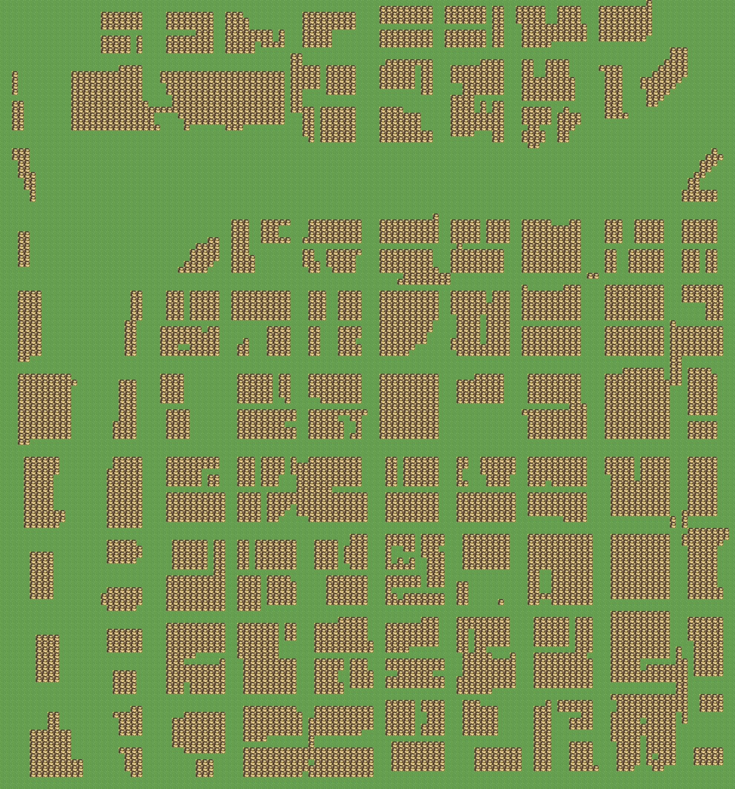
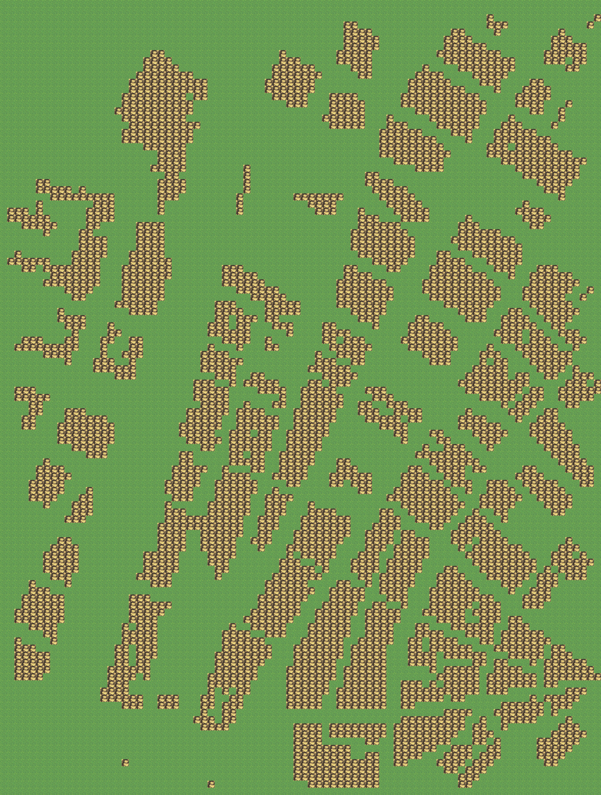
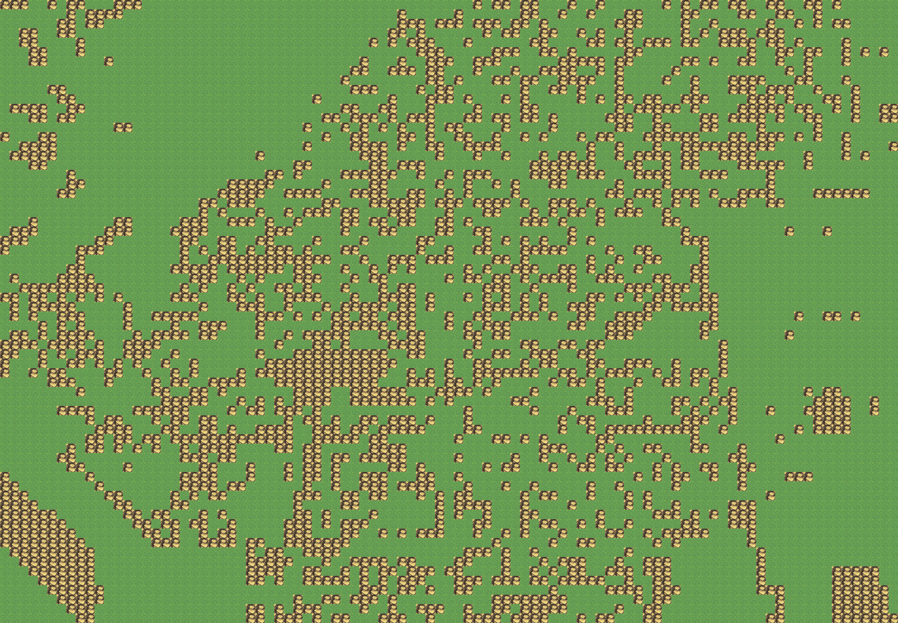
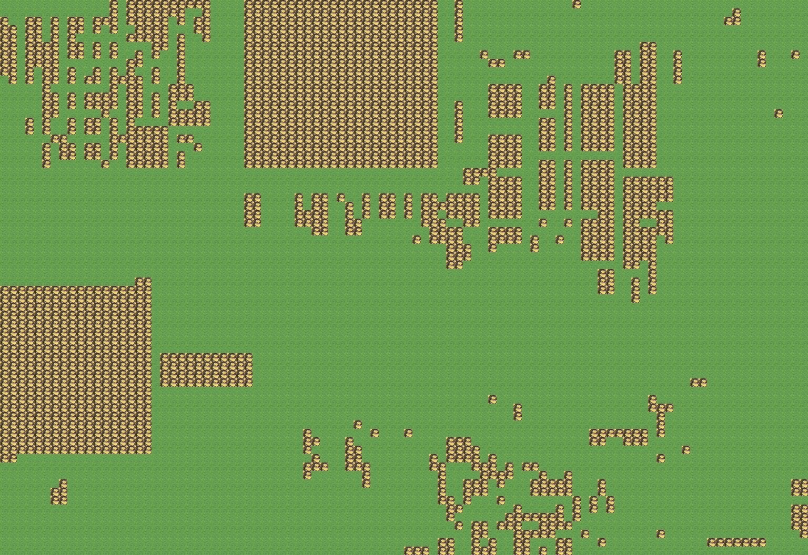

# Four cached cities, painted and listed

2026-11-25. Flat paints of the four slices that were already on disk. London, Paris, Tokyo, and the other `later` catalog rows were not pulled.

Cell size is 10 m. Kind is building footprints only, so streets are the grass gaps. `SHORE | off` keeps the border as grass. The harbour flood stays on for Centon, which does not set that row.

| Book | Page | Grid | Buildings | Paint |
|---|---|---|---|---|
| chicago-loop | board | 124 x 133 | 6583 | chicago.png |
| nyc-fidi | board | 84 x 111 | 3256 | nyc.png |
| jerusalem-old | board | 95 x 66 | 1993 | jerusalem.png |
| giza-plateau | board | 96 x 66 | 1712 | giza.png |

## How they open

Same path as Bay slice and Centon. Each book is `@.apps/<id>/rooms.pdl` plus one desk `board`, stood up by `rta_stand_op` (glyph B is height 3). The editor map folder has a symlink next to `bay-slice` and `centon`. The book shows up the next time the rpg-edit board is opened. This session did not relaunch that window and did not change the Earth moth page.

Play still starts shared `game_core`. It does not call the city ops. There is no road spawn (`road_x=-1`). Licenses on the source rows are still NOT CHECKED. Do not publish the pictures.

## External references

- Painter: `44.xyz.01.00/@.apps/rta/ops/rta_city_op.c` (`SHORE | off`, commit 6878babc7 on grok)
- Stand-up: `44.xyz.01.00/@.apps/rta/ops/rta_stand_op.c`
- Caches and projections, not in git: `#.NNEST_ASSETS/rta-sources/`, `rta-chicago/`, `rta-nyc/`, `rta-jerusalem/`, `rta-giza/`
- Inventory: `#.NNEST_ASSETS/rta-sources/INVENTORY.pdl`
